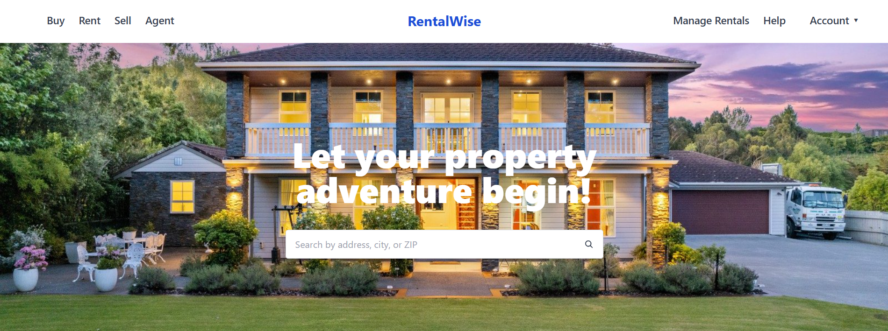
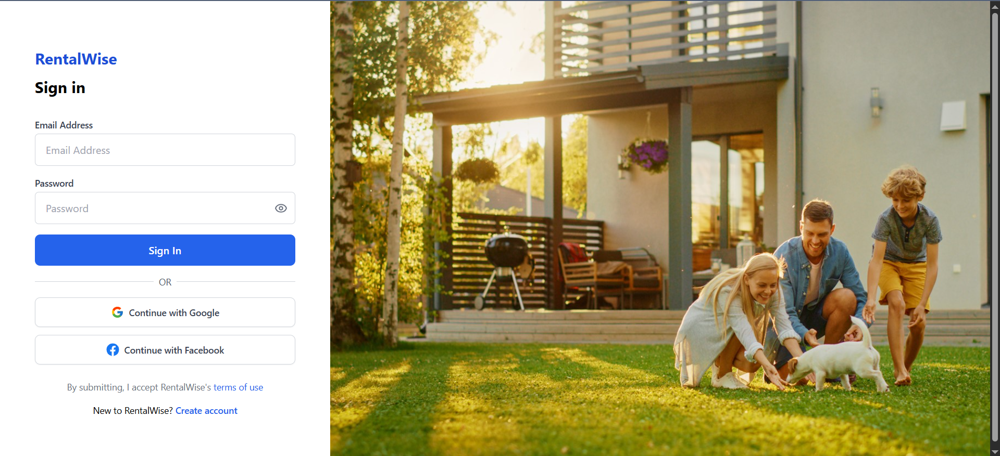
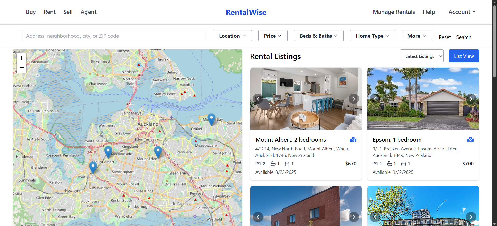
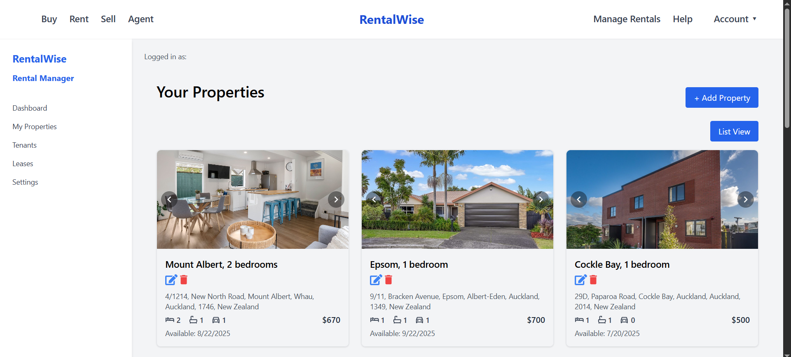
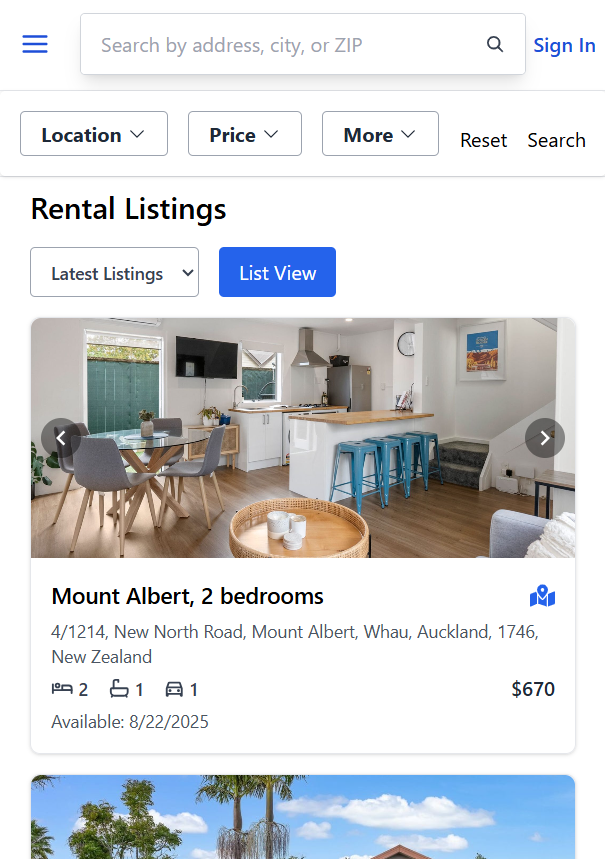

# 🏡 RentalWise

RentalWise is a modern, full-stack **property management web application** built with **ASP.NET Core** and **React**. It streamlines rental processes for **landlords** and **tenants**, offering features such as property listing, smart filters, secure logins, dashboards, and media galleries.

---

## 📌 Table of Contents

- [🚀 Features](#-features)
- [🤖 AI Maintenance Agent](#-ai-maintenance-agent)
- [⚙️ Tech Stack](#️-tech-stack)
- [📷 Screenshots](#-screenshots)
- [📁 Project Structure](#-project-structure)
- [🚀 Getting Started](#-getting-started)
- [📦 API Endpoints](#-api-endpoints)
- [🧪 Testing](#-testing)
- [🗺 Roadmap](#-roadmap)
- [🙋‍♂️ Author](#-author)
- [📄 License](#-license)

---

## 🚀 Features

### 👩‍💼 Landlord Features
- Add, edit, and delete properties
- Upload property media (images/videos)
- Manage tenants and leases
- View properties in card or list view
- Zillow-style map interactions
- Filter/search properties
- Maintenance queue with urgent issues shown first, the tenant's report, and the AI-drafted message
- Move maintenance requests through Submitted → Acknowledged → In progress → Resolved

### 🧑‍💻 Tenant Features
- View available properties with filters
- Apply for rentals
- Report maintenance issues through an AI assistant that drafts the request for you
- Track the status of your maintenance requests
- Dashboard to manage profile, payments (coming soon)

### 💻 Admin Features (Coming Soon)
- Manage users and content
- View system analytics

### 🌐 UI & UX
- Responsive UI (Mobile, Tablet, Desktop)
- Interactive filters and modals
- Clean navigation and role-based redirects

---

## 🤖 AI Maintenance Agent

Tenants describe a problem in their own words ("the bathroom ceiling is leaking") and an AI agent, powered by **Google Gemini**, turns it into a structured maintenance request for the landlord. **The agent only drafts. Nothing is saved until the tenant approves it.**

### How it works

1. **Access check:** the tenant must have a current lease on the property before the model is called at all.
2. **Tool phase:** the agent can call two read-only tools:
   - `get_property_details`: address, property type, rooms, smoke alarms and the tenant's lease dates
   - `get_maintenance_history`: the tenant's own earlier requests for that property, to spot repeats

   Each tool checks the tenant's access again, using the arguments the model sent, so the model is never trusted to pick a property. The number of tool rounds and calls is capped.
3. **Structured answer:** the agent must return JSON that matches a schema: category, urgency, title, summary, reasoning, confidence and a draft message to the landlord. If it asks follow-up questions, the tenant can answer them in the chat.
4. **Validation:** the server checks the answer again. If the JSON is invalid, the model gets one chance to correct it.
5. **Safety policy:** whether an issue is escalated is decided by plain code (`MaintenanceSafetyPolicy`), not by the AI:
   - Gas or fumes **always** escalate.
   - Electrical, flooding, structural/roof and smoke alarm issues escalate at **High** urgency or above.
   - Anything rated **Emergency** escalates.

   Escalated issues show the tenant safety steps (for example, leave the property, or call 111), so a model that under-rates a gas leak can't hide the warning.
6. **Duplicate check:** open requests in the same category from the last 30 days are shown as possible duplicates.
7. **Tenant approval:** the tenant approves, edits or rejects the draft. Creating the request uses an idempotency key, so a double-click can't create two requests. A likely duplicate returns `409` unless the tenant confirms.
8. **Audit trail:** each request keeps a timeline (Created, Triaged, Tenant changed the AI's suggestion, Escalation flagged, Status changed). It also records which Gemini model produced the assessment.

### Guardrails

- The agent never contacts tradespeople or emergency services, and never says anyone has been contacted.
- It never promises timeframes, costs or approvals, and gives no legal advice.
- If the primary model is busy or retired, the server falls back to other Gemini models and records which one actually answered.

### Configuration

Set the Gemini API key with user-secrets or an environment variable, never in a committed file:

```bash
dotnet user-secrets set "Gemini:ApiKey" "<your-key>" --project RentalWise.API
```

or set the `GEMINI_API_KEY` environment variable.

Optional settings in `appsettings.json` (the values shown are the defaults):

```json
"Gemini": {
  "Model": "gemini-3.7-flash",
  "FallbackModels": ["gemini-3.6-flash", "gemini-3.5-flash", "gemini-3-flash-preview"],
  "TimeoutSeconds": 45,
  "MaxRetries": 2
},
"MaintenanceAgent": {
  "MaxToolIterations": 4,
  "MaxTotalToolCalls": 8,
  "DuplicateLookbackDays": 30,
  "RetryOnInvalidJson": true
}
```

### Trying it locally

Reporting maintenance requires a current lease, and there's no lease management screen yet. In **Development only**, sign in as a tenant and call:

```
POST /api/maintenance/dev/demo-lease?propertyId={id}
```

This gives that tenant a 12-month demo lease on the property. The endpoint returns `404` in any other environment.

---

## ⚙️ Tech Stack

**Frontend**
- React.js
- TypeScript
- Tailwind CSS
- React Router
- Axios

**Backend**
- ASP.NET Core Web API
- Entity Framework Core
- ASP.NET Core Identity
- SQL Server 

**AI**
- Google Gemini API (tool calling + structured JSON output)

**Testing**
- xUnit
- Moq
- EF Core InMemory
- React Testing Library (optional)

---

## 📷 Screenshots

<!-- Add your own screenshots here -->
Home


Auth


Property List


Landlord Dashboard


Mobile View


Report Maintenance (Tenant: AI assistant)


Maintenance Request (Landlord: urgent escalation)


---

## 📁 Project Structure

```bash
RentalWise/
├── client/                      # React Frontend
│   ├── src/components/
│   ├── src/pages/
│   └── src/services/
│
├── server/                      # ASP.NET Core Backend (DDD structure)
│
│   ├── Api/                     # API Layer: Controllers, middleware, startup config
│   │   └── Controllers/
│
│   ├── Application/             # Application Layer: Use cases, DTOs, interfaces
│   │   └── Services/
│   │   └── Features/
│
│   ├── Domain/                  # Domain Layer: Entities, Value Objects, Interfaces, Enums
│   │   └── Entities/
│   │   └── ValueObjects/
│
│   ├── Infrastructure/          # Infrastructure Layer: EF Core DbContext, Repositories, Identity
│   │   └── Data/
│   │   └── Repositories/
│   │   └── Identity/
│
├── tests/                       # Automated Tests
│   ├── UnitTests/               # Unit tests for Application & Domain layers
│   ├── IntegrationTests/        # Integration tests using EF Core InMemory or SQLite
│   └── TestUtilities/           # Mocks, seed data, helpers

```

## 🚀 Getting Started

Backend (ASP.NET Core)
```
cd server
dotnet restore
dotnet ef database update
dotnet run
```
Frontend (React)
```
cd client
npm install
npm run dev
```
⚠️ Make sure to create .env files in both client/ and server/ directories to define environment variables like:
```
REACT_APP_API_BASE_URL
ConnectionStrings__DefaultConnection
```
## 📦 API Endpoints

🛡️ Auth
```
POST /api/auth/register/{role} – Register a new user (Landlord, Tenant, Admin)

POST /api/auth/login – Login and receive JWT token
```
👨‍💼 Landlord
```
POST /api/landlord – Create landlord profile

GET /api/landlord – Get current landlord

PUT /api/landlord – Update landlord details

DELETE /api/landlord – Delete landlord account
```
📍 Locations
```
GET /api/locations/regions – Get all regions

GET /api/locations/regions/{regionId}/districts – Get districts by region

GET /api/locations/districts/{districtId}/suburbs – Get suburbs by district

GET /api/locations/suburb/search – Search suburb by name
```
🏠 Properties
```
GET /api/properties – Get all properties (optional filters)

POST /api/properties – Add new property

GET /api/properties/{id} – Get property by ID

PUT /api/properties/{id} – Update property

DELETE /api/properties/{id} – Soft delete property

PUT /api/properties/restore/{id} – Restore deleted property

DELETE /api/properties/hard/{id} – Permanently delete property

POST /api/properties/search – Search/filter properties with criteria
```
👥 Tenants
```
POST /api/tenants – Create tenant profile

GET /api/tenants – Get current tenant

PUT /api/tenants – Update tenant details

DELETE /api/tenants – Delete tenant account
```
🛠️ Maintenance
```
GET   /api/maintenance/my-properties          – Properties the tenant currently leases (Tenant)

POST  /api/maintenance/triage                 – Run the AI agent; returns a draft, writes nothing (Tenant)

POST  /api/maintenance/requests               – Create the approved request; idempotent, 409 on duplicate (Tenant)

GET   /api/maintenance/requests               – Tenant: own requests · Landlord: requests on their properties

GET   /api/maintenance/requests/{id}          – One request with its audit timeline

PATCH /api/maintenance/requests/{id}/status   – Update request status (Landlord)

POST  /api/maintenance/dev/demo-lease?propertyId={id} – Create a demo lease (Development only, Tenant)
```

## 🧪 Testing

Run All Tests
```
cd tests
dotnet test
```

Technologies Used
- xUnit – Test framework for .NET
- Moq – Mocking services and interfaces
- EF Core InMemory – Lightweight provider for DB-less integration testing

Covered so far
- `MaintenanceSafetyPolicyTests` – checks the safety escalation rules (which categories and urgencies escalate, and the safety advice shown)

## 🗺 Roadmap
 ✔Property CRUD

 ✔Landlord dashboard

 ✔Role-based authentication

 ✔Search & filter

 ✔Map integration

 ✔AI maintenance triage agent (Gemini)

  Lease management UI

 Tenant application flow

  Payment integration

  Admin panel

  Email notifications

  Mobile-friendly enhancement
  
---

## 🙋‍♂️ Author

Sanduni Gamage
---


